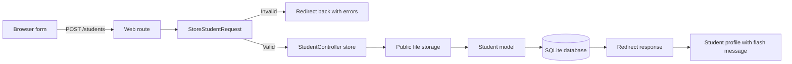
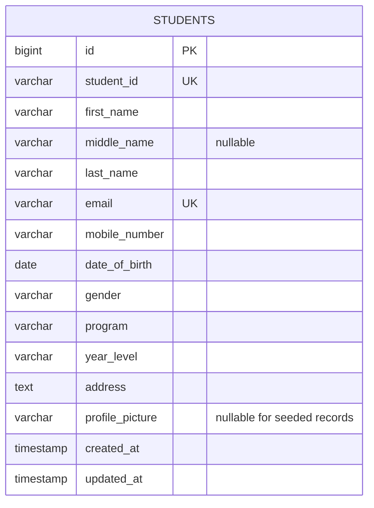
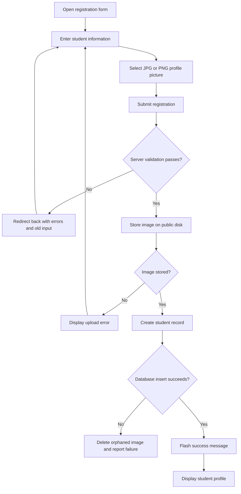

# Student Registration System

## 1. Project Title

**Mini Project 03: Student Registration System with Laravel Forms, Validation, and File Upload**

This project was developed for ITST 302 – Client-Server Technologies, Week 4. It uses Laravel 13, Blade, Tailwind CSS 4, and SQLite for local development. The database configuration can later be changed to MariaDB by following the [database setup guide](docs/database-setup.md).

## 2. Introduction

The Student Registration System replaces paper-based registration with a structured web application for collecting, validating, and reviewing student information. It records identity, contact, and academic details, accepts a profile picture, reports validation errors, and displays the completed student profile after a successful submission.

Data validation is essential because registration records support communication, enrollment, reporting, and other institutional processes. Invalid email addresses, duplicate student numbers, malformed phone numbers, or unsafe uploads can reduce data quality and expose the application to security risks. The system therefore validates every submission on the server and reinforces uniqueness at the database level.

Registration systems are common in universities and other enterprise environments because they provide a consistent entry point for data used by multiple departments and workflows. A reliable registration process helps keep downstream records accurate, searchable, and ready for future integration.

## 3. Objectives

The completed project demonstrates how to:

- Build responsive forms and profile pages with Blade and Tailwind CSS.
- Define resource routes and process requests through a Laravel controller.
- isolate validation in a dedicated Form Request.
- Preserve valid old input and display field-specific validation messages.
- Enforce unique student IDs and email addresses.
- Securely validate and store public profile images.
- Persist student records through Eloquent and database migrations.
- Display flash messages and redirect to the created student profile.
- Test successful submissions, validation failures, uploads, uniqueness, and output escaping with Pest.

### Getting Started

The project requires PHP 8.3 or newer, Composer, Node.js with npm, and SQLite support. For a fresh clone, run:

```bash
composer run setup
php artisan storage:link
composer run dev
```

Open the URL printed by the development server. The home page displays the student directory, while `/students/create` opens the registration form. Run the automated tests with:

```bash
php artisan test --compact
```

Optional demonstration records can be created with `php artisan db:seed --class=StudentSeeder`.

## 4. Laravel Request Lifecycle

Laravel receives the submitted `POST /students` request through its public entry point and web middleware. The named resource route sends it to `StudentController::store`, but the injected `StoreStudentRequest` validates and authorizes the request before the controller method executes. Valid data and the generated image path are passed to the `Student` model, which inserts the record into the configured SQLite database. The controller then flashes a success message and returns a redirect response to the new profile page. Invalid input is redirected back automatically with errors and old form values.



## 5. Validation Rules

| Field | Rules | Purpose |
| :--- | :--- | :--- |
| Student ID | Required, string, maximum 50 characters, unique | Prevents missing or duplicate institutional identifiers. |
| First and last names | Required strings, maximum 100 characters | Ensures every record can be identified while limiting excessive input. |
| Middle name | Optional string, maximum 100 characters | Supports students who do not have or use a middle name. |
| Email | Required, normalized to lowercase, valid email, maximum 255 characters, unique | Produces a usable contact address and avoids duplicate accounts. |
| Mobile number | Required string containing 10–15 digits | Accepts only numeric digits while preserving leading zeroes. |
| Date of birth | Required date before today | Rejects missing, malformed, or future dates. |
| Gender | Required value from the displayed options | Prevents unexpected values from bypassing the form choices. |
| Program | Required supported program | Keeps academic program data consistent for filtering and reporting. |
| Year level | Required value from first through fourth year | Restricts enrollment data to supported year levels. |
| Address | Required string, maximum 1,000 characters | Collects contact information without allowing unbounded text. |
| Profile picture | Required image; JPG, JPEG, or PNG; maximum 2 MB | Blocks unsupported files and limits storage and upload size. |

Validation is performed on the server because browser attributes can be removed or bypassed. The `student_id` and `email` columns also have unique database indexes, providing a final integrity constraint if concurrent requests pass application validation at nearly the same time. Only validated, fillable attributes are mass-assigned to the model.

## 6. Database Design

The application currently uses `database/database.sqlite`. Laravel's migration remains portable to MariaDB because it uses Schema Builder types rather than database-specific SQL. The `profile_picture` column stores a relative path, not image bytes; uploaded files are placed under `storage/app/public/student-profile-pictures` and exposed through `public/storage`.



| Column | Migration type | Constraints |
| :--- | :--- | :--- |
| `id` | Auto-incrementing integer | Primary key |
| `student_id` | String, 50 characters | Required, unique |
| `first_name` | String, 100 characters | Required |
| `middle_name` | String, 100 characters | Nullable |
| `last_name` | String, 100 characters | Required |
| `email` | String, 255 characters | Required, unique |
| `mobile_number` | String, 20 characters | Required |
| `date_of_birth` | Date | Required |
| `gender` | String, 30 characters | Required |
| `program` | String, 100 characters | Required |
| `year_level` | String, 20 characters | Required |
| `address` | Text | Required |
| `profile_picture` | String, 255 characters | Nullable at schema level; required for form submissions |
| `created_at`, `updated_at` | Timestamps | Managed by Eloquent |

## 7. Registration Flowchart



## 11. Reflection

Building this Student Registration System reinforced that validation is not merely a form feature; it is a boundary that protects the quality and safety of an application’s data. A registration page may look simple, but every field represents an assumption that must be checked. Student IDs and email addresses must be unique, dates must be realistic, phone numbers must retain leading zeroes, and uploaded files must actually be acceptable images. Encoding these expectations in a dedicated Form Request made the rules visible, reusable within the request flow, and easier to test than placing everything directly in the controller.

The project also clarified the difference between client-side and server-side validation. HTML attributes such as `required`, `type="email"`, `pattern`, and file accept filters improve the user experience by giving immediate feedback. However, a user or automated client can bypass those controls and send a request directly to the server. Server-side validation is therefore the authoritative check. Laravel automatically redirects invalid browser requests, flashes the previous input, and makes validation errors available to Blade, which creates a helpful experience without weakening the security boundary. Database unique indexes add another layer by protecting identifiers even when two valid-looking requests arrive close together.

File handling was one of the most important lessons. An uploaded filename and extension cannot be trusted on their own, so the application checks the file as an image, restricts the accepted formats to JPG and PNG, and limits the size to 2 MB. Laravel generates the stored filename and saves the file on the public disk while the database stores only its relative path. Keeping file content out of the student table makes the schema smaller and separates relational data from filesystem concerns. The controller also removes the uploaded file if database creation fails, preventing an unused file from being left behind. Creating the storage symbolic link then provides a controlled public URL for displaying the image.

Using SQLite during development made setup quick because the database is a single local file and requires no separate server. At the same time, using Laravel migrations and Eloquent keeps the application ready for MariaDB. This separation showed why framework abstractions are useful: application behavior can remain stable while infrastructure changes through environment configuration. The migration also documents the table shape, required values, nullable middle name, timestamps, and unique constraints in a repeatable form.

Finally, the project demonstrated how registration systems support real enterprise workflows. Accurate student data can later feed enrollment, communication, identity verification, reporting, and support services. A poor registration boundary spreads bad data into every connected process, while a carefully validated one creates a dependable source of truth. The combination of clear user feedback, server-side rules, database constraints, secure storage, and automated tests makes the system more trustworthy and maintainable. These practices apply beyond universities to employee onboarding, healthcare intake, banking applications, customer accounts, and other systems where people submit important information.

## 12. References

Laravel. (2026). *Directory structure*. https://laravel.com/framework/docs/13.x/structure

Laravel. (2026). *File storage*. https://laravel.com/framework/docs/filesystem

Laravel. (2026). *Request lifecycle*. https://laravel.com/framework/docs/13.x/lifecycle

Laravel. (2026). *Validation*. https://laravel.com/framework/docs/13.x/validation

PHP Documentation Group. (n.d.). *POST method uploads*. PHP Manual. https://www.php.net/manual/en/features.file-upload.post-method.php

SQLite Consortium. (n.d.). *Datatypes in SQLite*. https://www.sqlite.org/datatype3.html

Tailwind Labs. (n.d.). *Responsive design*. Tailwind CSS. https://tailwindcss.com/docs/responsive-design
